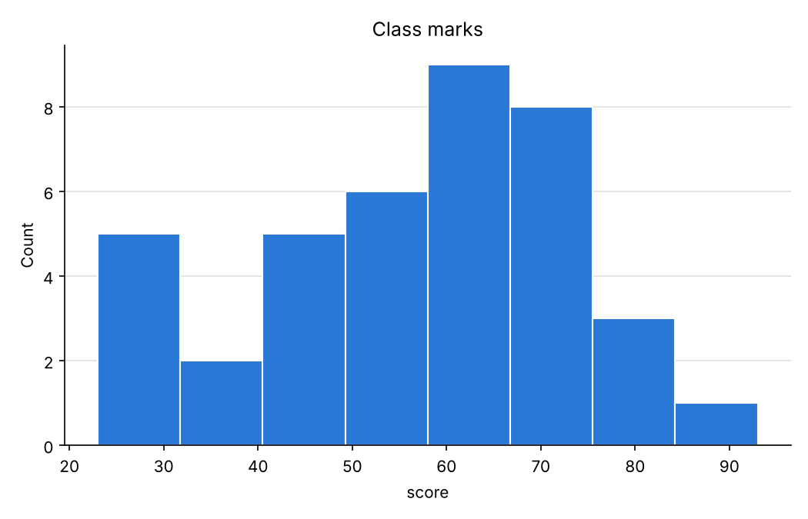
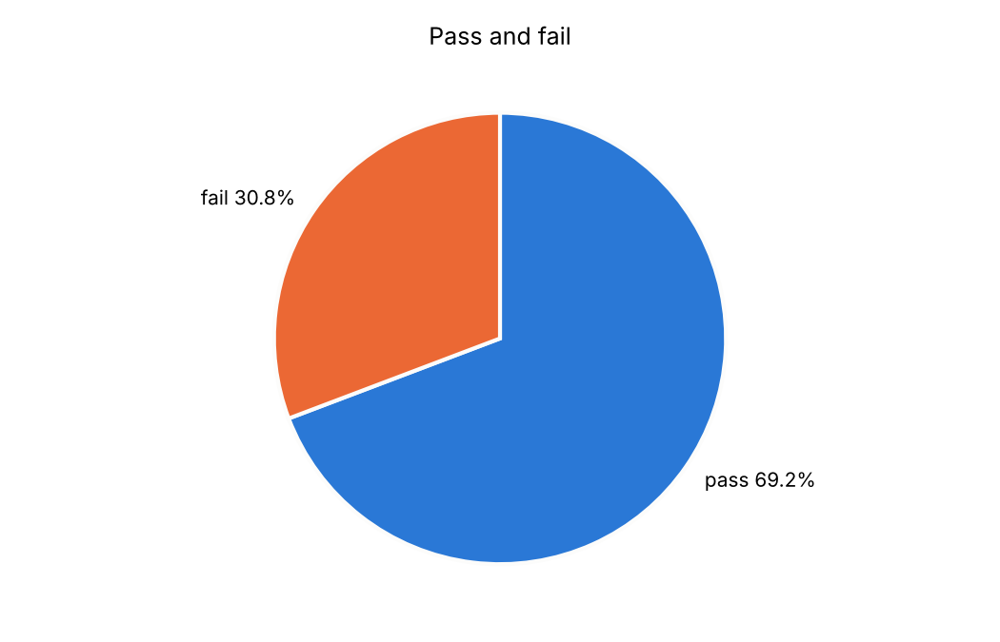
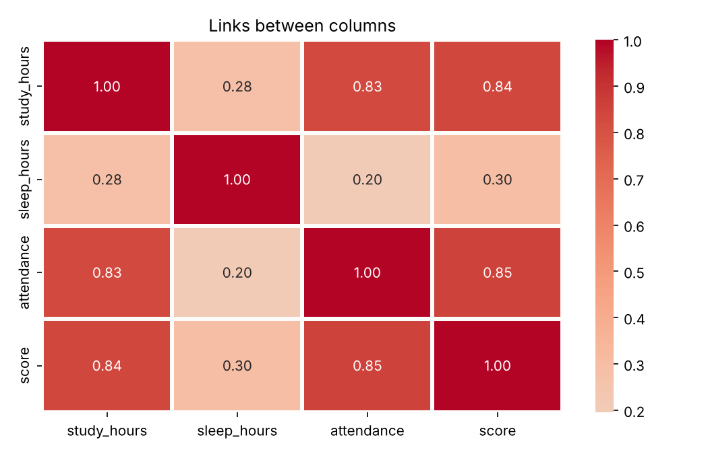
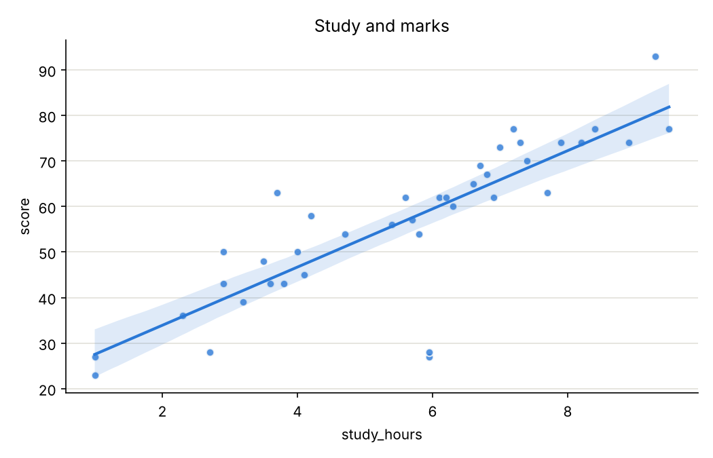

# Ψ-LEX

*Ψ-LEX is written Psi-LEX in plain letters where a symbol cannot go, as in the name of this repository. Say it “sigh-lex”.*

Data-science programs written in symbols, with exactly what they print and draw.

Each example is a program in symbols (`program.sym`) next to what it produced (`output.txt`, and its charts). Every program was run, and the output is what came out. This repository shows the programs and their results; the program that runs the symbols is not part of it.

## Why Ψ-LEX

Ψ-LEX is a way for an AI to write a program in symbols. A person can read it too, once the symbols are known.

- **AIs will write most programs.** So Ψ-LEX is made for the one who writes, an AI, and for the one who checks. It is not made for typing by hand.
- **A symbol means one thing.** Once an AI has learned the symbols, each one carries its meaning exactly, so there is less to get wrong. This is the bet of Ψ-LEX. It has not been measured yet.
- **A symbol can stand for a whole block of work.** Where a program is made of standard blocks it becomes much shorter (see [Tokens](#tokens)). Where every line is new logic it does not, and it can even cost a little more. More blocks, and bigger blocks, are the way to shorten more programs.
- **The machinery stays out of sight.** The plan is that the blocks, the engine and the translator all live in a data centre. An AI never reads their code: it writes symbols, sends them, and the answer comes back.
- **Data science first, then ordinary programs.** Ordinary programs need loops, choices and functions in symbols as well, with the same blocks doing the standard work.

Not shown yet: that symbols make an AI write fewer wrong programs, the data-centre arrangement (today the engine runs in a notebook), and ordinary programs (this repository has data science only). [TOKENS.md](TOKENS.md) says what is measured and what is not.

## One program

```
marks ← ↓ "marks.csv"
^ marks, 3
μσ marks
marks ← ∅ marks, "study_hours", ½
marks ← ✂ marks, "score"
marks ← ▯ marks
marks ← ▮ marks
marks ← ≡ marks
█ marks, "score", 8, "Class marks"
◔ marks, "result", "Pass and fail"
▦ marks, "Links between columns"
╱ marks, "study_hours", "score", "Study and marks"
ρ marks, "study_hours", "score"
inputs ← ["study_hours", "sleep_hours"]
m ← θ marks, inputs, "score", ╱
✓ m
ŷ m, [6, 7]
```

What it printed:

```
Loaded 40 rows and 7 columns from marks.csv.
The first 3 of 40 rows of marks:
  class  year study_hours sleep_hours  attendance  score result
0     A  2025         8.4         5.9          91     77   pass
1     B  2025         6.3         6.6          93     60   pass
2     C  2025         7.9         7.9          97     74   pass
marks: 40 rows and 7 columns.
     column    kind  missing smallest biggest average
      class   words        0                         
       year numbers        0     2025    2025    2025
study_hours numbers        2        1     9.5    5.56
sleep_hours numbers        0      4.5     8.8    6.63
 attendance numbers        0       64     100   84.12
      score numbers        0       23     999   80.15
     result   words        0                         
Filled 2 gaps in study_hours with the middle value (5.95).
Removed 1 row where score is far from the rest (999).
No column is more than 50% empty.
Removed the column year: it is the same on every row.
No row appears twice.
Drawing a histogram of score in 8 bars.
Chart saved as charts/chart_1.png.
Drawing a pie chart of result.
Chart saved as charts/chart_2.png.
Drawing the links between the number columns of marks.
Chart saved as charts/chart_3.png.
Drawing the dots of study_hours and score, with the line that fits them best.
Chart saved as charts/chart_4.png.
study_hours and score: link 0.84, a strong upward link. When study_hours is higher, score tends to be higher. A link does not prove that one causes the other.
The answer "score" is a number with many different values, so I guess a number.
Taught a straight line on 31 rows and tested it on 8 others.
On average the guess for score is off by 2.83.
The model explains 89% of the ups and downs in score.
For study_hours 6 and sleep_hours 7 the guess is 59.8.
```

<p>




</p>

## How to read a line

```
name ← symbol values     keep the result under a name
symbol values            show the result: a table, numbers or a chart
```

A symbol is followed by its values, separated by commas: names made earlier, numbers, a list in square brackets, or text in quotes. Column names, titles and file names are your own words, in any language.

## Tokens

An AI pays for every token it writes. The same work in ordinary Python and in Ψ-LEX, counted with a public tokenizer (the numbers are approximate; two other tokenizers agree within about 5 percent):

| Kind of program | Programs | Ordinary Python | Ψ-LEX | Ψ-LEX as a share of ordinary |
|---|---|---|---|---|
| Data science, as in this repository | 16 | 3,044 tokens | 872 tokens | 29% |
| Ordinary programs where standard blocks fit (estimate) | 18 | 3,202 | 2,100 to 2,300 | 66% to 71% |
| Ordinary programs of new logic (estimate) | 2 | 675 | 650 to 740 | 96% to 110% |

The first row is measured, and it is the best case: the symbols were made for these programs. The other two rows are estimates from test programs that are not in this repository, counted with stand-in signs. Where every line is new logic there is little to shorten, and rare signs can cost more than the words they replace. Every program, the ordinary versions and the method are in [TOKENS.md](TOKENS.md).

## The symbols

| Symbol | What it does | Why this sign |
|---|---|---|
| **Bring data in, send it out** | | |
| `↓?` | ask you for a file (upload) | ↓ brings a file in, ? asks you which one |
| `↓` | bring a table in from a file | arrow down: bring a file in |
| `✎` | make a ready-made practice table | a pencil: practice |
| `↑` | save a table to a file | arrow up: send a file out |
| **Look at it** | | |
| `^` | show the first rows of a table | ^ means the start (in search patterns and in the vi editor) |
| `μσ` | describe every column of a table | mean and spread: the textbook way to describe a table |
| `σ` | summary of a list or of one column | spread: a one-line summary of a list or a column |
| `ρ` | how strongly two columns are linked | rho: correlation, how strongly two things move together |
| `μ` | average of some columns for each group | mu: the mean |
| `Σ` | add up an amount for each month | sigma: the sum |
| `¶▲` | most common words in a text column | ¶ is text, ▲ is the peak: the most common |
| **Clean it** | | |
| `✨` | tidy a list or a table in one step | a sparkle: make it tidy |
| `∅` | fill empty cells in some columns | the empty set: fill what is empty |
| `✂` | cut out rows with an extreme value in a column | scissors: trim the extremes |
| `▯` | drop columns that are mostly empty | an empty column |
| `▮` | drop columns with the same value in every row | a solid column: every value the same |
| `≡` | drop rows that appear twice | identical to: rows that are the same |
| **Prepare** | | |
| `⌚` | read a column as dates, with the shape written as d m y H M S, for example "d/m/y" | a watch: these are dates and times |
| **Learn and guess** | | |
| `θ` | teach a model to guess one column from other columns | theta: the numbers a model learns |
| `θ¶` | teach a model to sort texts | a model (θ) for text (¶) |
| `κ` | sort rows into k groups of similar rows | kappa is the Greek k: k groups (k-means) |
| `⇅` | rank the inputs by how much they matter | sort arrows: put in order of importance |
| `✓` | check a model on rows it has not seen | a tick: check it |
| `✓✗` | show where a model is right and where it is wrong | ticks and crosses |
| `ŷ` | guess for new values | y-hat: the predicted value |
| **Draw** | | |
| `█` | histogram | bars |
| `◔` | pie chart | a pie |
| `⊟` | box plot of a column for each group | a box with its middle line |
| `╱` | dots with the line that fits them best | a straight line |
| `▦` | map of the links between the number columns | a grid of shades |
| `•` | dots of two columns, coloured by group if one is given | dots |
| `~` | line chart | a wavy line |
| **One-line recipes** | | |
| `⚡§` | a whole report of a table in one line | ⚡ quick + § a report |
| `⚡ŷ` | a whole guess in one line: clean a copy, try two models, keep the better | ⚡ quick + ŷ predict |
| **Choices written as symbols** | | |
| `μ` | fill empty cells with the average | the mean |
| `½` | fill empty cells with the middle value | the half-way value (the median) |
| `▲` | fill empty cells with the most common value | the peak (the mode) |
| `╱` | a straight line model | a straight line |
| `⋔` | a decision tree model | a fork: a tree of questions |
| `⋔⋔` | a random forest model | many forks: many trees |
| `ℝ` | the answer is a number | the real numbers |
| `∈` | the answer is a class (a label) | belongs to a set of labels |

34 command symbols: 17 are signs that already carry this meaning (mathematics, statistics, everyday screen icons), 12 are small pictures of the thing, and 5 are new choices. The signs `μ` and `╱` are in the table twice: at the start of a line they are commands, and in the place of a value they are choices.

## All examples

| # | What it does | Symbols used | Program | Output |
|---|---|---|---|---|
| 01 | A full study of exam marks: look, clean, draw, find the link, guess | `↓` `^` `μσ` `∅` `✂` `▯` `▮` `≡` `█` `◔` `▦` `╱` `ρ` `θ` `✓` `ŷ` | [program](examples/01_full_study/program.sym) | [output](examples/01_full_study/output.txt) |
| 02 | Will a student pass? Rank the inputs, teach a forest, sort rows into groups | `↓` `✨` `⇅` `θ` `✓` `✓✗` `ŷ` `⊟` `κ` `μ` `•` | [program](examples/02_pass_or_fail/program.sym) | [output](examples/02_pass_or_fail/output.txt) |
| 03 | Sales added up by month, and good or bad reviews | `↓` `⌚` `Σ` `~` `↑` `¶▲` `θ¶` `✓` `ŷ` | [program](examples/03_sales_and_reviews/program.sym) | [output](examples/03_sales_and_reviews/output.txt) |
| 04 | What is in this file? | `↓` `^` `μσ` | [program](examples/04_look_at_a_table/program.sym) | [output](examples/04_look_at_a_table/output.txt) |
| 05 | A typed list with one typing mistake | `✨` `σ` | [program](examples/05_clean_a_list/program.sym) | [output](examples/05_clean_a_list/output.txt) |
| 06 | A whole file with gaps, a wrong value and a useless column | `↓` `∅` `✂` `▯` `▮` `≡` `↑` | [program](examples/06_clean_a_file/program.sym) | [output](examples/06_clean_a_file/output.txt) |
| 07 | The shape of the data in three charts | `↓` `█` `◔` `▦` | [program](examples/07_draw_charts/program.sym) | [output](examples/07_draw_charts/output.txt) |
| 08 | Which class does best? | `↓` `μ` `⊟` | [program](examples/08_compare_groups/program.sym) | [output](examples/08_compare_groups/output.txt) |
| 09 | Do students who study more get better marks? | `↓` `╱` `ρ` | [program](examples/09_test_a_link/program.sym) | [output](examples/09_test_a_link/output.txt) |
| 10 | Teach the computer to guess a score, then guess for a new student | `↓` `θ` `✓` `ŷ` | [program](examples/10_guess_a_number/program.sym) | [output](examples/10_guess_a_number/output.txt) |
| 11 | Say pass or fail, and show where it goes wrong | `↓` `θ` `✓` `✓✗` | [program](examples/11_guess_yes_or_no/program.sym) | [output](examples/11_guess_yes_or_no/output.txt) |
| 12 | Are there kinds of students? Sort them into 3 groups | `↓` `κ` `μ` `•` | [program](examples/12_find_groups/program.sym) | [output](examples/12_find_groups/output.txt) |
| 13 | Which column matters most for the score? | `↓` `⇅` | [program](examples/13_rank_what_matters/program.sym) | [output](examples/13_rank_what_matters/output.txt) |
| 14 | Which words come up most, and can it tell good reviews from bad ones? | `↓` `¶▲` `θ¶` `✓` `ŷ` | [program](examples/14_words_in_text/program.sym) | [output](examples/14_words_in_text/output.txt) |
| 15 | Dates over time: sales for each month, drawn as a line | `↓` `⌚` `Σ` `~` | [program](examples/15_dates_over_time/program.sym) | [output](examples/15_dates_over_time/output.txt) |
| 16 | A whole report, and a guess, one line each | `↓` `⚡§` `⚡ŷ` | [program](examples/16_one_line_recipes/program.sym) | [output](examples/16_one_line_recipes/output.txt) |
| 17 | Two ways to bring data in: a file, or a ready-made practice table | `↓` `✎` | [program](examples/17_bring_data_in/program.sym) | [output](examples/17_bring_data_in/output.txt) |

*Draft 2.*
